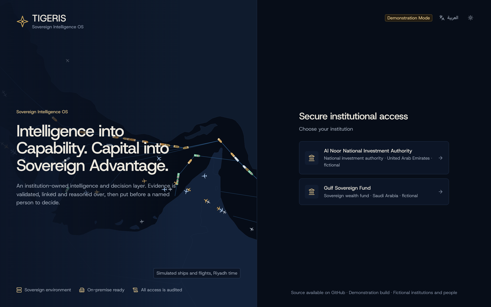
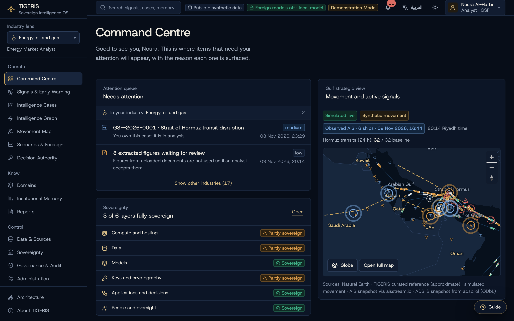
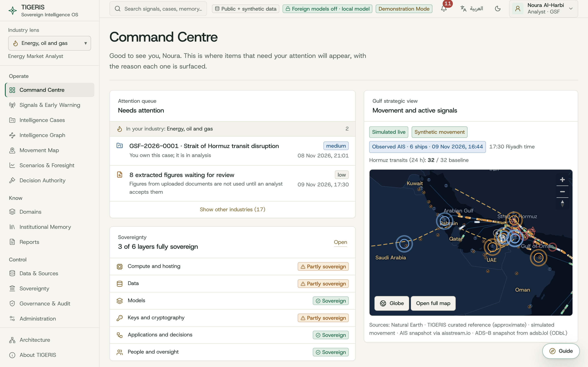
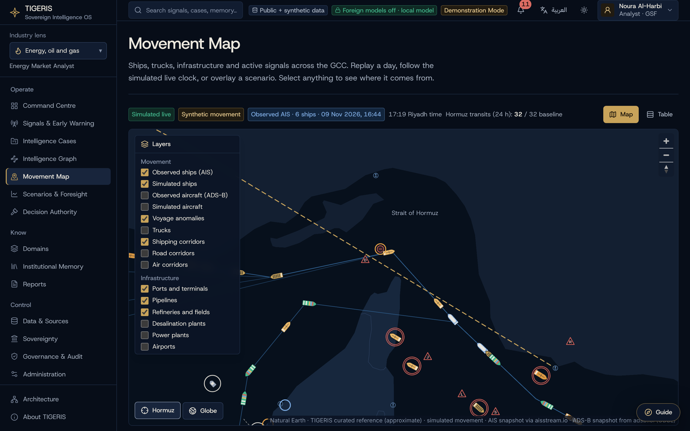
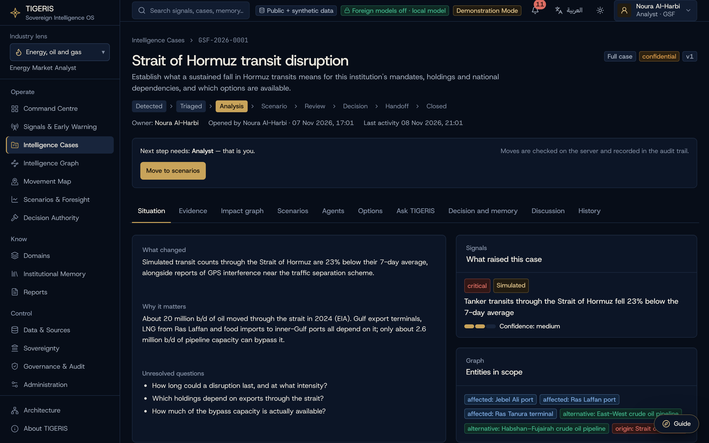
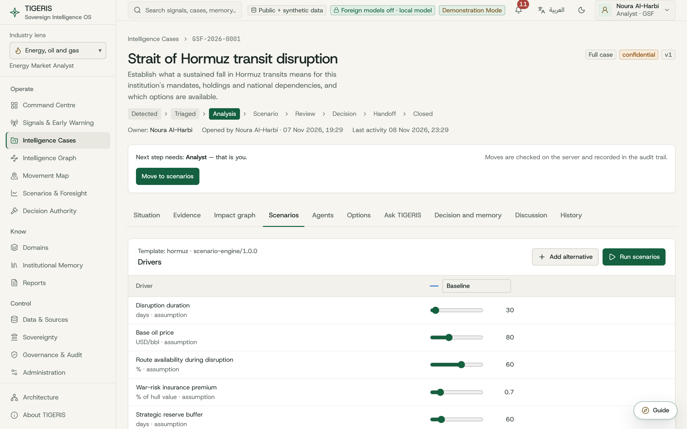
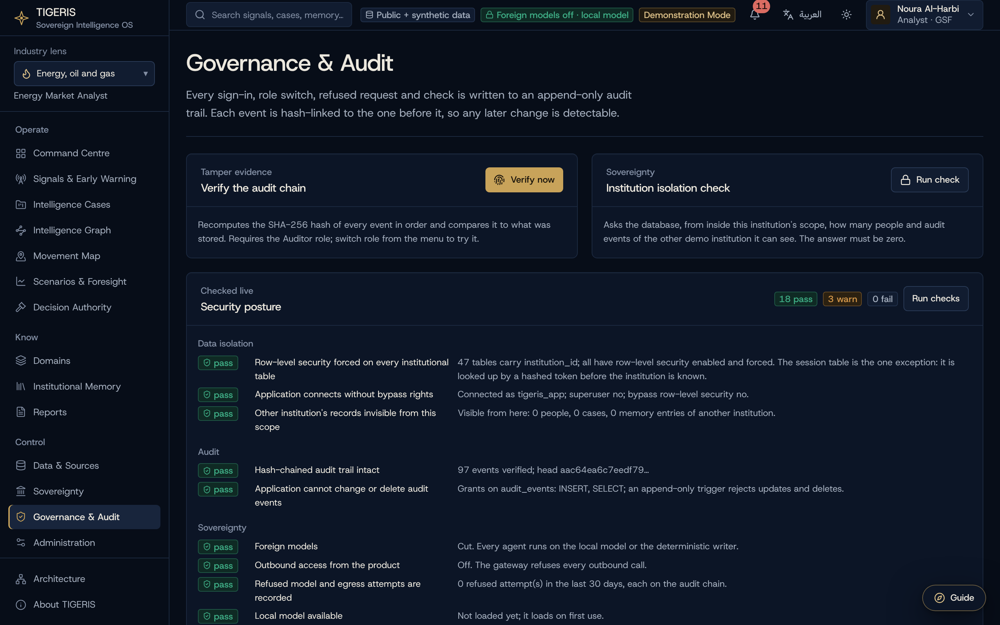
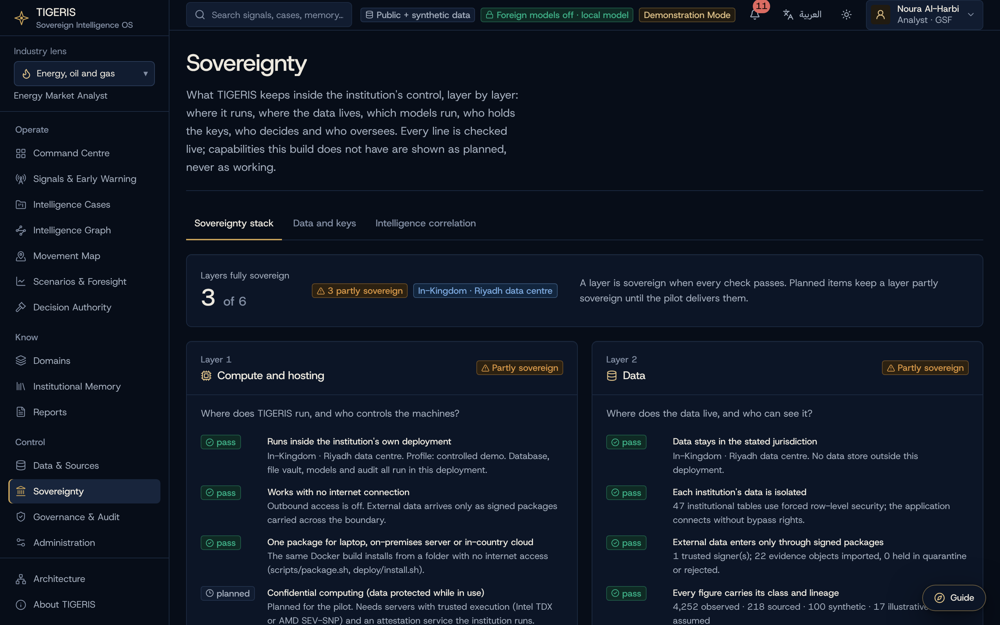
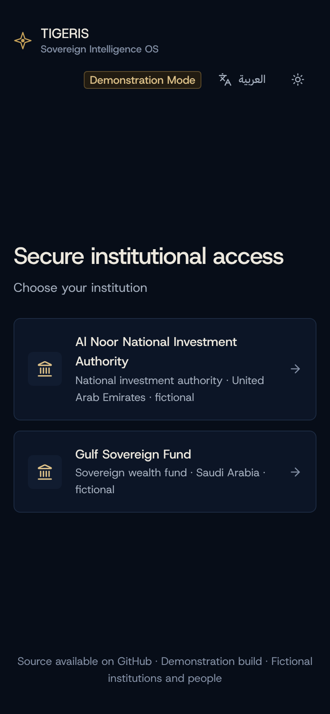
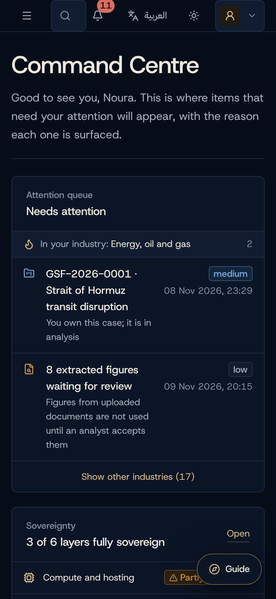

<div align="center">

# TIGERIS · Sovereign Intelligence OS

**An institution-owned intelligence and decision layer for sovereign institutions.**
Validated evidence, a shared intelligence graph, governed reasoning and named human decisions, all inside the institution's own boundary.

`Demonstration build` · `Fictional institutions and people` · `Public + synthetic data` · `Outbound access off by default`

</div>



<table>
  <tr>
    <td></td>
    <td></td>
  </tr>
</table>

## What it does

TIGERIS follows a question from the first signal to a recorded decision:

1. **Signals and early warning.** Public sources and simulated feeds raise signals. Each one says why it was surfaced and how confident it is.
2. **Intelligence cases.** A signal becomes a case with an owner, a state machine (detected → triaged → analysis → scenario → review → decision → handoff → closed) and a policy-checked next step.
3. **Intelligence graph and movement map.** Entities, dependencies and exposures form one graph. An offline basemap of the Gulf shows real ships observed by AIS near Hormuz, plus simulated shipping, trucking, pipelines and lanes, each clearly labelled.
4. **Scenarios and foresight.** A deterministic Python engine runs multi-horizon scenarios. Every number traces back to a fact or a labelled assumption, and the price response is calibrated by a back-test on real EIA Brent history.
5. **Bounded agents.** Ten agents analyse a case on a local open-weight model. They get numbers only from tools; their text is checked against the evidence or marked UNVERIFIED.
6. **Options and decisions.** Recommendations are scored and policy-checked, but nothing executes. A named human decides, a second person approves where policy requires it, and the decision can be replayed and checked for drift.
7. **Institutional memory.** Fifty precedents plus the institution's own approved case records, searchable by keyword and by meaning.
8. **Governance and audit.** Policy as code, a hash-chained append-only audit trail, a live security posture, redacted exports and a sovereignty switch for foreign models.



<table>
  <tr>
    <td></td>
    <td></td>
  </tr>
</table>

## Principles built into the code

| Principle | How it is enforced |
|---|---|
| Each institution's data stays its own | PostgreSQL row-level security (forced) on every institutional table; the app connects without bypass rights; a live check proves the other institution is invisible. |
| Every change is accountable | Every protected mutation writes an audit event in the same transaction. Events are hash-chained and the table is append-only. |
| No model is the source of truth | Arithmetic, policy and authority live in deterministic TypeScript and Python. Model text must cite evidence or is shown UNVERIFIED. |
| Sovereign by default | Outbound access is off. All model calls pass one gateway: allowlist, foreign-model switch, classification ceiling, egress rule, key. |
| Every number has lineage | Displayed numbers link to their sources and assumptions; synthetic data is always labelled. |
| Humans decide | Recommendations only. Separation of duties is enforced, and decisions name the person who made them. |
| Accessible and Arabic-ready | Status is never colour alone, reduced motion is respected, and key screens run in Arabic (RTL). |





<table>
  <tr>
    <td width="50%"></td>
    <td width="50%"></td>
  </tr>
</table>

## Architecture

```
            outside the boundary          │                inside the institution's boundary
                                          │
  public sources ──► tools/collector ──► signed snapshot ──► apps/api (Fastify, TypeScript)  ◄──► apps/web (Next.js)
                     (fetch + sign)       package          │  identity · cases · policy · audit
                                          │                │  model gateway · agents · memory
                                          │                ├──► PostgreSQL 16 + pgvector (row-level security)
                                          │                └──► services/reasoning (FastAPI, Python)
                                          │                      scenario engine · back-test · local models
```

| Path | Purpose |
|---|---|
| `apps/web` | Next.js 15, React 19, Tailwind 4, Motion and GSAP: sign-in, OS shell and every module |
| `apps/api` | Fastify API: identity, sessions, cases, policy, decisions, memory, model gateway, agents, audit |
| `packages/shared` | Roles, permission matrix and shared labels |
| `services/reasoning` | Python: scenario engine, back-test, local language and embedding models |
| `tools/collector` | Runs outside the boundary: fetches public sources and signs a transfer package |
| `db/migrations` | Plain SQL migrations with row-level security |
| `deploy`, `scripts` | Offline package, install script, VM overlay with automatic TLS |
| `docs` | Scope, architecture decisions (`docs/adr`), weekly progress notes, demo script |

The design system is specified in [`DESIGN.md`](DESIGN.md) (version 2.1). It follows the [taste skill](https://github.com/Leonxlnx/taste-skill) (MIT, installed in `.agents/skills`) for type, motion and copy, with motion built on [Motion](https://motion.dev) and [GSAP](https://gsap.com) for sequenced entrances (both bundled, reduced motion respected). Quality is checked against [UI/UX Pro Max](https://github.com/nextlevelbuilder/ui-ux-pro-max-skill) (MIT, in `.claude/skills`): contrast of at least 4.5:1 in both themes, 44px touch targets, no text under 12px; earlier structure came from the Linear and IBM analyses in [VoltAgent/awesome-design-md](https://github.com/voltagent/awesome-design-md) (MIT). The brand, navy and gold, is TIGERIS's own.

## Quick start

### Docker

```bash
docker compose up --build
```

Open http://localhost:3000, choose an institution, then **Demo entry** and a role. The MFA step shows its demo code on screen.

### Local development

Requirements: Node 22, pnpm 10, Python 3.13 and PostgreSQL 16 with pgvector.

```bash
psql -U postgres -f db/init/00-roles.sql
```
```bash
pnpm install
```
```bash
pnpm db:migrate && pnpm db:seed
```
```bash
pnpm dev
```

The web app runs on port 3000 and the API on 4000. Scenarios and the API tests also need the reasoning service:

```bash
cd services/reasoning && python3 -m venv .venv && .venv/bin/pip install -r requirements-dev.txt
```
```bash
cd services/reasoning && .venv/bin/uvicorn app.main:app --port 8000
```

### Local models

Model weights are not in the repository. Without them the agents fall back to a deterministic writer and memory search uses keywords only.

```bash
mkdir -p data/models
```
```bash
curl -L -o data/models/qwen2.5-1.5b-instruct-q4_k_m.gguf https://huggingface.co/Qwen/Qwen2.5-1.5B-Instruct-GGUF/resolve/main/qwen2.5-1.5b-instruct-q4_k_m.gguf
```
```bash
curl -L -o data/models/bge-small-en-v1.5-q8_0.gguf https://huggingface.co/CompendiumLabs/bge-small-en-v1.5-gguf/resolve/main/bge-small-en-v1.5-q8_0.gguf
```
```bash
services/reasoning/.venv/bin/pip install -r services/reasoning/requirements-llm.txt
```

Foreign models are optional and off by default. To use one, set `ANTHROPIC_API_KEY` or `OPENAI_API_KEY` (plus `OPENAI_MODEL`) in the deployment environment. An administrator then has to allowlist the provider, switch foreign models on, allow outbound access and set the classification ceiling in Governance & Audit.

### Offline package (laptop or VM)

```bash
TIGERIS_VERSION=demo docker compose build
```
```bash
scripts/package.sh demo
```

This writes `dist/tigeris-demo/` with the images, models, signed data, `install.sh` and checksums. Copy it to the target machine and run `./install.sh`, or `TIGERIS_DOMAIN=… ./install.sh vm` for a VM with automatic TLS. See [`deploy/README-package.md`](deploy/README-package.md).

### Refresh the public data snapshot

```bash
pnpm --filter @tigeris/collector collect
```

Then import the new package from **Data & Sources**, or run `pnpm db:seed` to reset and import.

### Real ships in the Strait of Hormuz (AIS)

The map can show real ships observed by AIS near Hormuz, next to the simulated traffic. The collector listens to [aisstream.io](https://aisstream.io) for a fixed window (30 minutes by default, up to 6 hours) and writes a signed snapshot. TIGERIS never connects to the feed itself. You need a free aisstream.io key:

```bash
AISSTREAM_API_KEY=your-key pnpm --filter @tigeris/collector ais -- --minutes 120
```

Then import the `ais-hormuz-*.tigpkg` package from **Data & Sources**, or run `pnpm db:seed`. Observed ships have a solid ring on the map, each value links to its capture, and **Hormuz** zooms to the strait. AIS packages are not committed to this repository, because the data stays under aisstream.io's terms. Pleasure craft and sailing yachts are dropped at capture.

The snapshot keeps each ship's full track in the window (one report a minute, at most 720), stored as a fact with lineage. The map draws the tracks, and the same voyage-anomaly checks used on the simulated ships (going dark, loitering, ship-to-ship meetings, position jumps) run on the real ones. Anything they find is raised as an observed signal that links to the capture. A longer window gives the checks more to work with; coverage near Hormuz depends on which receivers feed aisstream.io and is often thin.

Real airline flights over the Gulf come from [adsb.lol](https://adsb.lol) (open data, ODbL) the same way, with no key: `pnpm --filter @tigeris/collector adsb`, then import the `adsb-gulf-*.tigpkg` package. Private and general-aviation aircraft are dropped at capture. Contains information from adsb.lol, made available under the ODbL.

## Tests

```bash
pnpm typecheck
```
```bash
pnpm test
```
```bash
cd services/reasoning && .venv/bin/pytest -q
```

The API tests need the database and the reasoning service running.

For coding agents working on this repository, [Ponytail](https://github.com/dietrichgebert/ponytail) (MIT) is in `.claude/skills`: `/ponytail` for the smallest complete change, `/ponytail-review` for a change, `/ponytail-audit` for the whole repo, `/ponytail-debt` to list `shortcut:` comments. Its auto-start hooks are not installed, so it runs only when called.

For browser checks by a coding agent, the repository includes [Playwright CLI](https://github.com/microsoft/playwright-cli) (`@playwright/cli`, Apache-2.0) and its skill in `.claude/skills/playwright-cli`. With the app running: `npx playwright-cli open http://localhost:3000/sign-in`, then `npx playwright-cli screenshot`. Its output goes to `.playwright-cli/`, which is not committed.

## Running the demo

[`docs/demo-script.md`](docs/demo-script.md) is a 25-minute talk track. The **Guide** button on every screen walks the same story: command centre → signal → case → scenarios → back-test → agents → options → decision → governance → memory → architecture. **Reset demo** in the user menu (top right) restores the starting state.

## Status

All eight weekly slices of the demonstration build are complete. See [`docs/SCOPE.md`](docs/SCOPE.md) for the scope and [`docs/progress`](docs/progress) for what each week delivered and verified.

Not yet done: a hosted VM, live foreign models, and client review of the Arabic terminology (currently a labelled draft).

## Notice

This is a public demonstration build. The source is published so it can be read and evaluated. No open-source licence has been chosen yet, so copyright law's default applies: you may view and fork it on GitHub, but not reuse or redistribute it without permission.

All institutions and people in this build are fictional. Data is public snapshots plus clearly labelled synthetic data. Third-party data keeps its own terms; see each source in Data & Sources.
